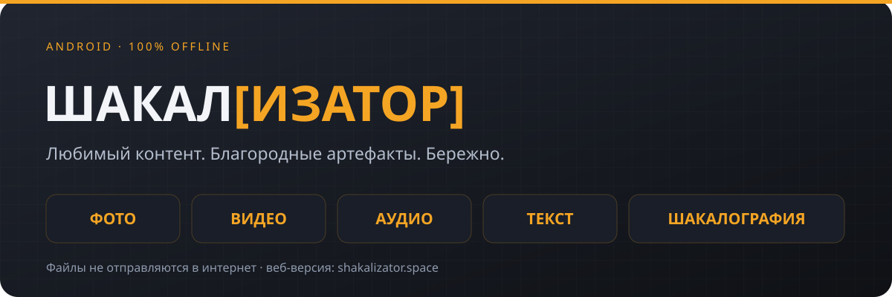
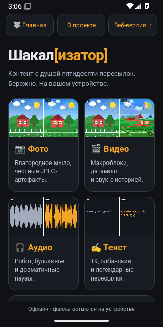

<div align="center">



**Всё семейство шакализаторов в одном офлайн-приложении Android.**

[](docs/INSTALL.md)
[](https://github.com/ChrysNeb/Shakalizator/actions/workflows/android.yml)
[](#приватность)

### [↓ Скачать APK](https://github.com/ChrysNeb/Shakalizator/releases) · [Инструкция](docs/INSTALL.md) · [Веб-версия ↗](https://shakalizator.space)

Фото, которое обрело душу. Ваше сообщение с характером. Бережно. На устройстве.

</div>

---

## Что это

**Шакализатор** — Android-приложение из оригинального веб-проекта. Оно придаёт фото, видео, звуку и тексту эстетику десятков пересылок: благородное мыло, честные квадраты, аутентичные JPEG-артефакты и тёплое бульканье.

Страницы, словари и FFmpeg включены в APK. Android WebView используется как локальный движок: приложение **не загружает интерфейс с сайта** и работает без сети. Есть системный выбор файлов, сохранение в выбранную папку, буфер обмена и запись с микрофона.

## Пять инструментов

| Инструмент | Что получается |
| --- | --- |
| **📷 Фото** | Уровни 1–10, настоящие JPEG-поколения, Paint / Nearest / Чистый; 12/10 — почти пиксель-арт |
| **🎬 Видео** | Макроблоки, датамош, провалы битрейта, шлейфы и звук с историей; MP4, в 12/10 — GIF |
| **🎧 Аудио** | Телефонная полоса, роботизированный тембр, хрип, бульканье и драматичные паузы; MP3, OGG/Opus, M4A |
| **✍️ Текст** | Т9, опечатки, раскладка, SMS-экономия, капс, кракозябры и олбанский |
| **🔐 Шакалография** | Шакало-криптография: AES-256-GCM и PBKDF2, фраза 12/24 слова, обратимая текстовая оболочка и PNG-пакет |

Это отдельное приложение для обработки файлов. **«Шакал Камера»** остаётся самостоятельным проектом для съёмки.

<details><summary><b>Скриншот приложения на Android 15</b></summary>

<p align="center"></p>

Настоящий скриншот из Android-эмулятора. На невысоком экране карточка Шакалографии и блок приватности находятся ниже по прокрутке.

</details>

## Есть веб-версия для телефона и компьютера

**[shakalizator.space](https://shakalizator.space)** — все инструменты в браузере: можно шакалить **фото, видео, текст, аудио**, а также шифровать сообщения через **шакало-криптографию «Шакалография»**.

Для поддерживаемых файлов обработка в веб-версии также выполняется **локально в браузере**: сами файлы не загружаются на сервер. Браузер скачивает страницы и движки обработки; это не отправка ваших фото, видео или текста.

В приложении кнопка «Веб-версия ↗» открывает сайт во внешнем браузере. Сам APK для обработки в интернете не нуждается.

## Приватность

**У приложения нет разрешения Android `INTERNET`.** Оно не может отправлять файлы, текст или фразу на сервер. Внешние ресурсы WebView дополнительно блокируются; локальные страницы открываются через `WebViewAssetLoader`, без сервера и без открытых портов.

- Все кодеки и словари — внутри APK, никаких CDN во время работы.
- Нет аналитики, рекламы, регистрации или аккаунтов.
- Файлы выбираются через системное окно: доступ ко всей памяти не запрашивается.
- Микрофон запрашивается только для записи аудио.
- Результат сохраняется в выбранную вами папку. Оригинал не перезаписывается приложением.
- Отправка через другое приложение происходит только по вашему действию. Дальше действуют правила выбранного мессенджера / браузера.

«Локально» не означает абсолютную защиту заражённого устройства. Шакалография — фан-инструмент без независимого аудита; не используйте её для гостайн. Фразу нельзя восстановить, если вы её потеряли.

## Установка

1. Откройте [Releases](https://github.com/ChrysNeb/Shakalizator/releases) и скачайте **Shakalizator-1.0.0.apk**.
2. Установите на Android **8.0+** с актуальным **Android System WebView**. Если Android попросит, разрешите установку из выбранного источника.
3. Выберите инструмент и файл. Для текста достаточно вставить сообщение.
4. Выберите уровень, обработайте и сохраните результат через системное окно.

Это предварительная debug-сборка для прямой установки, не релиз Google Play. [Подробная инструкция →](docs/INSTALL.md)

## FAQ

<details><summary><b>Это бесплатно?</b></summary>

Да: без регистрации, водяных знаков и ограничений по количеству обработок. Есть технические ограничения размера / длины конкретных файлов.

</details>
<details><summary><b>Куда загружаются файлы?</b></summary>

Никуда. Обработка идёт на устройстве; файлы не отправляются в интернет. Временные данные могут находиться в локальной памяти приложения, а результат сохраняется туда, куда вы укажете.

</details>
<details><summary><b>Чем отличается от обычной пикселизации?</b></summary>

Пикселизация просто снижает разрешение. Шакализатор создаёт реальные поколения пережатия, JPEG-блоки, ореолы, мыло и кодековые артефакты. Для чётких квадратов есть 12/10.

</details>
<details><summary><b>Работает ли без интернета?</b></summary>

Да. Всё необходимое включено в APK. Интернет нужен только если вы сами откроете веб-версию, GitHub или отправите результат через другое приложение.

</details>
<details><summary><b>Почему видео и аудио обрабатываются долго?</b></summary>

Это несколько проходов кодирования на вашем телефоне, а не облачный сервер. Начните с 5–15 секунд и держите приложение открытым. При нехватке памяти выбирайте файл поменьше.

</details>
<details><summary><b>Что такое 12/10?</b></summary>

Высокое искусство: пиксельный режим для изображения / видео, «8-бит» для звука, двойные кракозябры для текста. В Шакалографии — особая оболочка и PNG-пакет.

</details>
<details><summary><b>Какие форматы поддерживаются?</b></summary>

Фото JPEG/PNG/WebP и другие форматы, которые декодирует WebView; видео MP4/MOV/WebM/MKV/GIF; аудио MP3/WAV/OGG/Opus/M4A/FLAC/AAC и звуковые дорожки видео. Возможность открыть конкретный файл зависит от формата и устройства. Произвольные архивы / документы не обрабатываются.

</details>

FAQ адаптирован из [веб-проекта](https://shakalizator.space), с уточнениями для Android.

## Для разработчиков

**Проверки:** 5 инструментальных тестов прошли на Android 15, 3 unit-теста и проверка потокового экспорта — успешно. Android Lint: 0 ошибок. [Подробности и границы проверки](TESTING.md).

```bash
git clone https://github.com/ChrysNeb/Shakalizator.git
cd Shakalizator
# JDK 17 и Android SDK 35; путь к SDK — local.properties
sh ./gradlew assembleDebug testDebugUnitTest lintDebug
```

На Windows — `gradlew.bat`. APK: `app/build/outputs/apk/debug/app-debug.apk`. Исходные веб-проекты не нужны для сборки: готовые страницы, словари и WASM уже включены.

- [Описание приложения для публикации](docs/DESCRIPTION.md)
- [Сборка и устройство проекта](docs/DEVELOPMENT.md)
- [Отчёт о проверках](TESTING.md)
- [Сторонние компоненты](docs/THIRD_PARTY.md)

---

<div align="center">

**Шакалы — это эстетика. Всё локально. Бережём каждый артефакт.**

[Веб-версия](https://shakalizator.space) · [Фото](https://pic.shakalizator.space) · [Видео](https://vid.shakalizator.space) · [Аудио](https://audio.shakalizator.space) · [Текст](https://txt.shakalizator.space) · [Шакалография](https://crypto.shakalizator.space)

</div>
